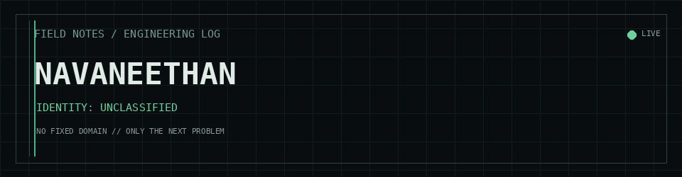

# NAVANEETHAN.P

`SUBJECT: UNCLASSIFIED` · `SIGNAL STATUS: ACTIVE`

**Curiosity → Experiments → Engineering → Reality**

I don't work within a single technical boundary. Some days it's software. Some days it's security. Sometimes it's an idea that turns into an entirely different system. I explore, break things, understand how they work, and build what comes next. The work speaks. The next move stays unknown.

<!-- DOSSIER:START -->
## 01 / FEATURED CASE FILES

Curated projects selected for inspection.

### CASE FILE / 01 — [FirstRun](https://github.com/Navaneethan-P/FirstRun)

A Python CLI that statically checks software repositories for first-run and onboarding issues — without executing repository code.

`Python` · `★ 1` · `PUSHED 16 OCT 2026`

---

### CASE FILE / 02 — [Phonepad](https://github.com/Navaneethan-P/Phonepad)

Turns an Android phone into an Xbox 360-compatible controller for Windows over Wi-Fi, hotspot, or USB tethering using ViGEmBus.

`Not specified` · `★ 0` · `PUSHED 24 NOV 2026`

---

### CASE FILE / 03 — [Intelligent-Candidate-Discovery](https://github.com/Navaneethan-P/Intelligent-Candidate-Discovery)

Hybrid semantic retrieval and candidate ranking system built with FAISS vector indexing, SentenceTransformers, and behavioral decay modeling.

`Python` · `★ 1` · `PUSHED 21 JUN 2026`

## 02 / LATEST SIGNAL

The most recently pushed eligible public repository.

### [forensic-ai-guard](https://github.com/Navaneethan-P/forensic-ai-guard)

Advanced digital threat detection and cyber-forensics platform.

`TypeScript` · `★ 0` · Last code push: **26 Nov 2026**

INDEX REFRESHED: 28 Nov 2026 · 08:02 UTC · SOURCE: PUBLIC GITHUB REPOSITORY METADATA
<!-- DOSSIER:END -->

## 03 / FIELD NOTES

- Understand the system before changing it.
- Treat claims as things to verify.
- Make the result clear enough for someone else to use.
- Prefer working evidence over impressive descriptions.

## 04 / TECHNICAL TERRAIN

Languages, tools, and engineering areas represented across public repositories.

**Languages:** Python, TypeScript, JavaScript  
**Workflow:** Git, automated tests, static checks, repository documentation  
**Areas explored:** Software engineering · AI-assisted systems · Developer tooling · Web and desktop software · Android & Windows integration · Security-oriented exploration

## 05 / REPOSITORY ARCHIVE

[Browse all public repositories](https://github.com/Navaneethan-P?tab=repositories)
